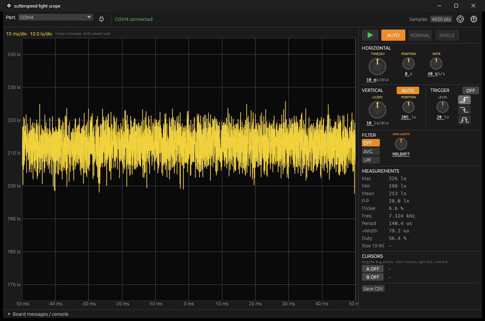

# sutterspeed

A light oscilloscope on a small USB board: a photodiode front end sampled at 400 kS/s, a Windows viewer
that works like a bench scope (time base, vertical scale, trigger, filters, measurements, cursors), and a
shutter measurement mode that times a single light pulse — the original purpose of the board was testing
camera shutter speeds.



## Hardware

- STM32C071G8 (Cortex-M0+, 48 MHz), USB full speed
- TEMD5510 photodiode, transimpedance stage (10 kΩ) followed by gains ×1 / ×11 / ×121
- the three stages are sampled together every 2.5 µs and merged into one wide-range value
  (the most sensitive stage that is not clipped; gain ratios are learned while running)

KiCad 10 project in [`kicad/`](kicad), fabrication files (BOM, positions, Gerbers) in [`kicad/production/`](kicad/production).

## Repository

| path | contents |
| --- | --- |
| [`firmware/src`](firmware/src) | firmware: ADC/DMA acquisition, scope engine (trigger, decimation, roll, pulse capture), USB CDC command line |
| [`firmware/tools/viewer-rs`](firmware/tools/viewer-rs) | Windows viewer (Rust, egui), also flashes firmware over USB DFU |
| [`firmware/test`](firmware/test) | host test of the scope engine with synthetic light pulses |
| [`firmware/lib`](firmware/lib) | CMSIS, STM32C0 HAL, TinyUSB (git submodules) |
| [`code/`](code) | STM32CubeMX pin configuration |
| [`kicad/`](kicad) | schematic and PCB |

Clone with the libraries:

```
git clone --recursive https://github.com/StaRadian/sutterspeed.git
```

## Viewer

Download `sutterspeed-viewer.exe` from the [releases](https://github.com/StaRadian/sutterspeed/releases), plug in the
board and pick its COM port.

- **Horizontal**: 10 µs/div .. 5 s/div, position, sample rate (400 kS/s and divisions of it). Long time bases roll live.
- **Vertical**: lx/div and position, AUTO follows the signal smoothly; drag the trace to move it.
- **Trigger** (10 ms/div and faster; slower time bases roll live): AUTO / NORMAL / SINGLE, rising or falling edge,
  level knob or drag the ◀ marker. While SINGLE waits, the previous trace stays on screen, dimmed.
- **Filter**: moving average or low-pass on screen; the board triggers on the same filtered signal.
- **Min width** (next to the filter): light has to stay past the level at least this long to trigger, so short flashes
  and flicker are passed over. 0 = off (shown as HOLDOFF).
- **Measurements**: max, min, mean, peak-peak, flicker, frequency, period, width, duty, rise time; cursors A/B.
- **Shutter measurement** (pulse icon under the trigger, works like SINGLE): waits for one light pulse and shows it
  from start to end. The open time runs from the light rising through the trigger level to it falling back through it
  (on the filtered trace when a filter is set), with the nearest nominal speed and the error in EV. The trigger looks
  at a 40 µs average (or the filter), the timing at the 2.5 µs samples. Pulses from about 100 µs to tens of seconds.
  ▶ goes back to the running scope.
- **Firmware update**: the chip icon flashes a `.hex`/`.bin` over USB (ST system bootloader, DfuSe),
  or from a script: `sutterspeed-viewer --flash sutterspeed.hex`.

Build: `cd firmware/tools/viewer-rs && cargo build --release`.

## Firmware

Build with [STM32CubeCLT](https://www.st.com/en/development-tools/stm32cubeclt.html) (arm-none-eabi-gcc, CMake, Ninja):

```
cd firmware
cmake -S . -B build -G Ninja
cmake --build build
```

See [`firmware/README.md`](firmware/README.md) for flashing and the serial protocol.

## Status and limits

- The lux scale comes from the datasheet (≈10 nA/lx for illuminant A, ≈15 counts per lx) and is not calibrated;
  other light sources (LED, daylight) can read tens of percent off. `zero` removes the dark offset only — cover the
  sensor when using it.
- The 2.5 µs samples are noisy (tens of lx at room light, and LED room light may flicker at tens of kHz);
  slower sample rates and the filters average it out. Set the shutter trigger level clearly above the room light.
- Measured on one board: stage ratios ×10.9 (×11 / ×1) and ×13.0 (×121 / ×11, nominal 11); the firmware learns
  them while running (`adc` and `gain` show them).

Copyright © 2026 StaRadian. All rights reserved. The libraries under `firmware/lib` keep their own licenses.
